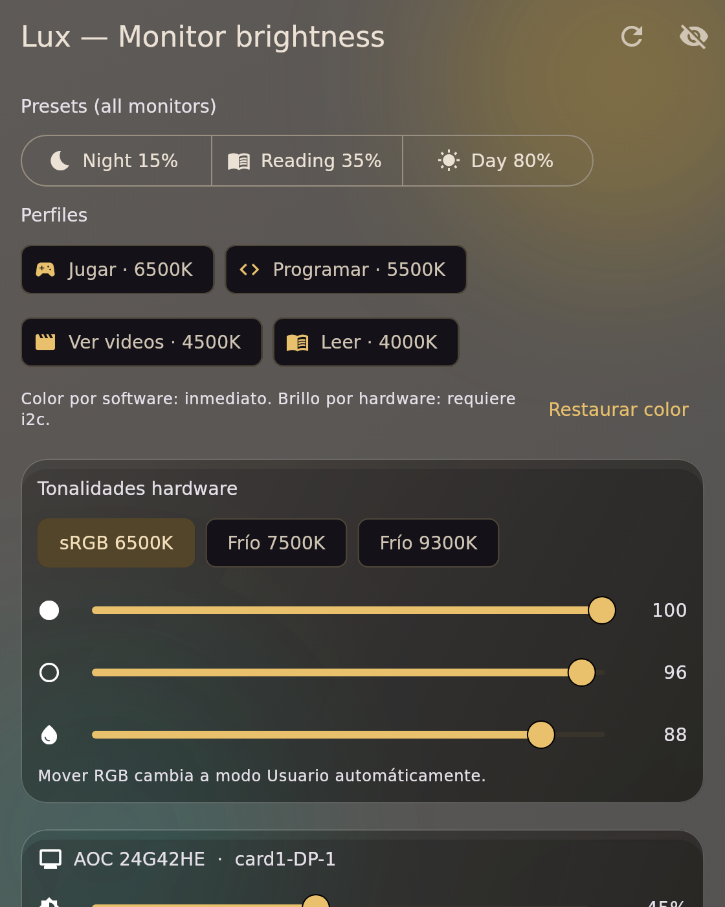
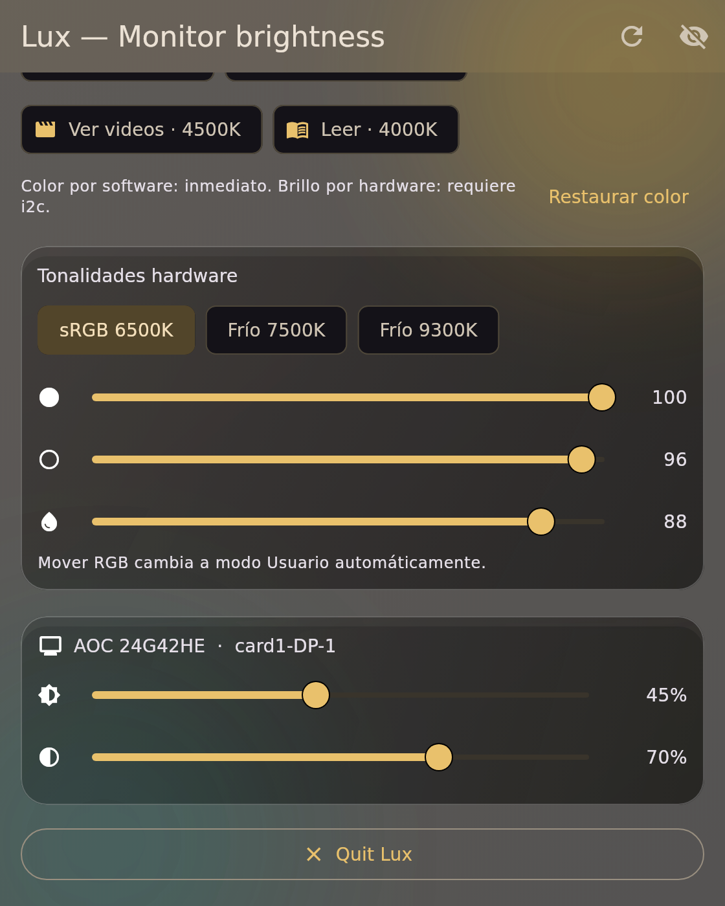
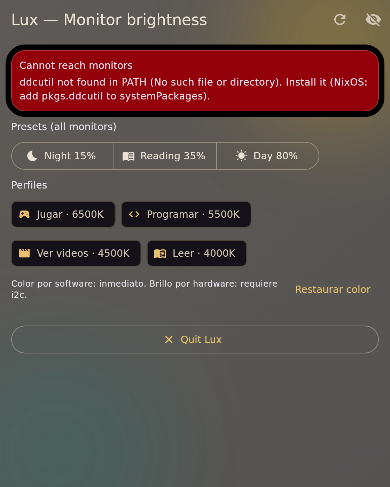

# Lux — DDC/CI monitor brightness for Linux

> Copyright 2026 Southwest AI Labs — Apache-2.0 (see `LICENSE`).

Flutter Linux app in the system tray. Controls REAL panel backlight via
DDC/CI (VESA MCCS over I2C) — unlike night-light filters, which only shift
colors and never lower the backlight.

## Screenshots

Rendered by the headless e2e suite (`flutter test test/e2e`), so they show the current UI.

<p align="center">
  
  
  
</p>

## Why this exists

Night-light / gamma filters only shift colors. If the screen still blinds
you at night, you need hardware brightness: VCP `0x10` over DDC/CI. Works
on practically every external monitor (DP/HDMI) from every brand.

## Approach (generic, verified on AOC 24G42HE)

- Transport: DDC/CI over the display cable (`ddcutil` CLI).
- Brightness `0x10` + contrast `0x12` (VESA MCCS standard).
- Cool tones in hardware: presets `0x14` = 6500/7500/9300K + User1,
  fine-tuned with RGB gains `0x16/0x18/0x1A` (gains need User1 first).
  ONLY these preset values are ever sent (capabilities allowlist).
- Warm tones (<6500K, impossible in this panel's hardware) via hyprshade
  screen shaders (`~/.config/hypr/shaders/lux-*.glsl`).
- This machine's wlr gamma path is broken ("gamma control of output DP-2
  failed"), so wlsunset/gammastep cannot work here — shaders bypass it.
- Profiles: Jugar (vibrance) / Programar 5500K / Videos 4500K / Leer 4000K.

## NixOS setup (required once, permanent)

```nix
hardware.i2c.enable = true;                       # creates /dev/i2c-*, i2c group
users.users.belal.extraGroups = [ "i2c" ];        # permission to talk to panels
environment.systemPackages = with pkgs; [ ddcutil ];
```

Then `sudo nixos-rebuild switch --flake /etc/nixos#swal` and **relogin**.
Verify with: `luxctl doctor`.

## Install / build (ephemeral shell, no system change)

```bash
nix-shell -p flutter cmake ninja pkg-config gtk3.dev glib.dev pango.dev \
  atk.dev gdk-pixbuf.dev cairo.dev libayatana-appindicator \
  --run "cd \"$HOME/proyectosSWAL/otras apps/lux\" && DESTDIR=/tmp/lux-build flutter build linux --release"
cp -r /tmp/lux-build/.../bundle/. ~/.local/share/lux/
```

Autostart (Hyprland): `exec-once = lux`

## Layout

```
lib/main.dart            entry: window + tray wiring
lib/src/ddc_service.dart ONLY place that speaks ddcutil (VCP codes)
lib/src/color_service.dart hyprshade profiles (shaders)
lib/src/tray_controller.dart StatusNotifier tray (Hyprland/Waybar)
lib/src/app.dart         glass settings window (sliders, profiles, tones)
lib/src/glass_card.dart  frosted-glass surface widget
lib/src/models.dart      MonitorInfo, LuxException, profiles, HW tones
lib/src/process_runner.dart Shell.run: the only seam that starts commands
scripts/luxctl           personal CLI (doctor, detect, set, profiles, tones)
test/                    parser + table unit tests (no hardware needed)
test/e2e/                headless app tests with FakeShell; screenshots in docs/screenshots
```

## Status

See `features.json`. v0.6.0: single instance (a second launch focuses the
running window), headless e2e suite with screenshots, latest dependencies.
Release gate: [docs/RELEASE.md](docs/RELEASE.md).

## Monitor compatibility

Lux talks DDC/CI (VESA MCCS, standard since 1998, same cable as video).
Rule of thumb: **any external monitor (DP/HDMI/DVI) with DDC/CI enabled
in its OSD works for brightness**. Check yours in 10 seconds:

```bash
luxctl doctor     # ddcutil + i2c + detection in one go
```

### Verified

| Monitor | Link | Brightness | Contrast | Presets 0x14 | RGB gains |
|---|---|---|---|---|---|
| AOC 24G42HE (DP, 200Hz) | DDC `AOC:24G42HE` | 0x10 OK | 0x12 OK | 6500/7500/9300/User1 OK | OK via User1 |

### Expected to work (same standard, same VCP codes)

Dell (P/U series), LG UltraGear/UltraFine external, Samsung Odyssey/
Smart Monitor, BenQ ZOWIE/PD, ASUS TUF/ProArt, MSI, Gigabyte, Philips,
ViewSonic, Acer — any external panel advertising DDC/CI or controllable
by DisplayBuddy (Windows) / MonitorControl (macOS) / ddcutil (Linux).
Those tools speak the exact same VCP codes Lux uses.

### Feature matrix (varies per panel — always read `capabilities` first)

| Feature | Code | Coverage |
|---|---|---|
| Brightness | 0x10 | near-universal on externals |
| Contrast | 0x12 | very common, not guaranteed |
| Color presets | 0x14 | values are panel-specific (this AOC: 5/6/8/11) |
| RGB gains | 0x16/0x18/0x1A | common on gaming/pro panels; often need User preset |
| Warmth <6500K in HW | — | does NOT exist on most panels → Lux uses shaders |

### NOT supported

- Laptop internal panels (backlight is ACPI/WMI, not DDC/CI).
- Monitors with DDC/CI disabled in the OSD (enable it first).
- Some USB-C portable monitors without a DDC channel.
- Apple Studio Display / Pro Display XDR (proprietary control).

### Report your panel

Paste `ddcutil capabilities` output in an issue: brand, model, link,
and which of brightness/contrast/presets/gains responded. The allowlist
in `DdcService` grows from real reports, never from guesses.

## Builds per OS

| OS | Status | How |
|---|---|---|
| Linux (x64) | Built here (`~/.local/share/lux`) | nix-shell recipe in this README |
| Windows (.exe) | NOT built here — needs a Windows machine (MSVC) | `flutter build windows --release` on Windows; runner in `windows/` |
| macOS (.dmg) | NOT built here — needs a Mac (Xcode) | `flutter build macos --release` on a Mac; runner in `macos/` |

Cross-compiling Flutter desktop from Linux is unsupported, so no honest
.exe/.dmg can come out of this machine. Portability notes:

- UI/tray/window code is already cross-platform (`tray_manager`,
  `window_manager` support all three).
- The DDC layer shells to `ddcutil` (Linux-only). Windows/macOS need a
  native backend each: Windows → Physical Monitor API (like Monitorian /
  ClickMonitorDDC); macOS → `ddcctl` for external monitors (internal
  panels use IOKit, a different API). `DdcService` is the single seam:
  implement per-OS runners behind it; VCP codes stay identical.
- Color profiles use hyprshade (Hyprland-only). Other compositors/DEs
  need their own filter path (GNOME Night Light, Windows Night light API,
  macOS Night Shift) — same seam, same profile table.
